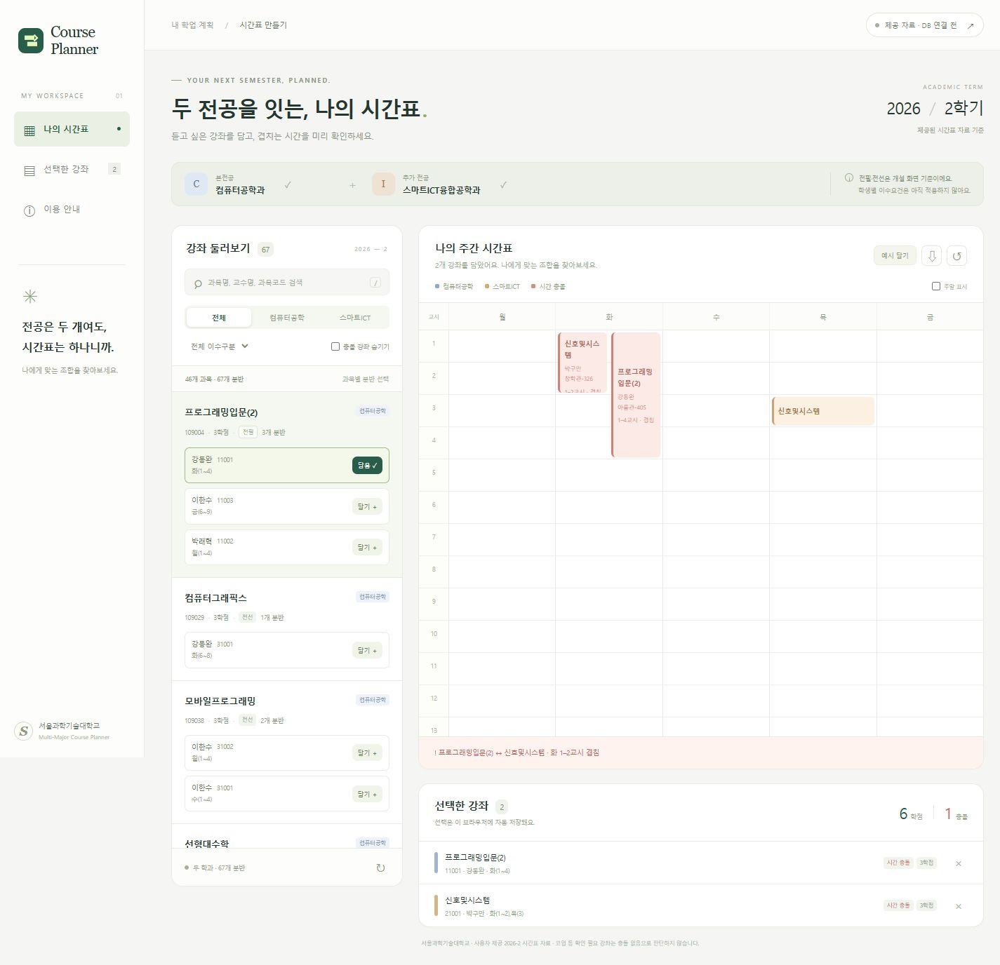

# Multi-Major Course Planner

**본전공과 부전공의 강좌를 한 화면에서 비교하고, 시간 충돌을 확인하며 자신에게 맞는 시간표를 구성하는 웹 애플리케이션입니다.**

서울과학기술대학교 컴퓨터공학과·스마트ICT융합공학과의 **2026년 2학기 자료**를 사용합니다.

> **빠른 실행:** Node.js 20 이상 설치 → 저장소 다운로드 또는 클론 → `web/start.cmd` 더블클릭
>
> **MySQL 설치 없이도 주요 기능을 모두 체험할 수 있습니다.** MySQL 연동은 선택 사항입니다.



## 1. 바로 실행하기 — Windows

### 준비

- **Windows + Node.js 20 이상**이 필요합니다. [Node.js 공식 설치 페이지](https://nodejs.org/en/download)에서 설치할 수 있습니다.
- Node.js 설치 시 기본 PATH 설정을 유지합니다. 이미 설치되어 있다면 터미널에서 `node --version`으로 버전을 확인할 수 있습니다.
- 별도로 설치할 패키지가 없어 **`npm install`은 필요하지 않습니다.**
- Git이 없어도 GitHub의 **Code → Download ZIP**으로 다운로드할 수 있습니다. ZIP은 먼저 압축을 해제해 주세요.

### 실행 순서

1. 저장소를 클론하거나 다운로드한 폴더를 엽니다.
2. **`web` 폴더 안의 `start.cmd`를 더블클릭**합니다.
3. 브라우저에서 **http://127.0.0.1:3000**이 자동으로 열립니다.
4. 처음에는 오른쪽 위에 **`제공 자료 · DB 연결 전`**이 표시됩니다. 정상 상태입니다.
5. 왼쪽 강좌 목록에서 **`담기 +`**를 눌러 시간표를 구성합니다.

실행 창은 사용하는 동안 열어 두세요. 창에서 **Enter**를 누르면 서버가 종료됩니다. 페이지를 다시 사용하려면 `start.cmd`를 다시 실행합니다.

macOS/Linux에서는 Node.js 설치 후 저장소의 `web` 폴더에서 다음 명령으로 실행할 수 있습니다. 자동 실행 파일 `start.cmd`는 Windows용입니다.

```sh
node server.mjs
```

브라우저에서 http://127.0.0.1:3000 에 접속합니다. 터미널에서 **Ctrl+C**로 종료합니다.

## 2. 충돌 탐지 체험하기

1. 처음 실행한 화면에서 **`예시 담기`**를 누릅니다.
2. 다음 두 강좌가 선택됩니다.

| 학과 | 과목 | 강좌번호 | 강의시간 |
| --- | --- | --- | --- |
| 컴퓨터공학과 | 프로그래밍입문(2) | 11001 | 화 1~4교시 |
| 스마트ICT융합공학과 | 신호및시스템 | 21001 | 화 1~2교시, 목 3교시 |

3. **화요일 1~2교시 충돌**이 빨간색으로 표시됩니다.
4. 프로그래밍입문(2)의 다른 분반인 **11003 — 금 6~9교시**를 담아 봅니다.
5. 같은 과목의 기존 분반이 교체되고, 위 두 강좌 사이의 충돌이 해소됩니다.

기존 선택을 모두 지우려면 시간표 오른쪽 위의 **초기화 버튼(↺)**을 사용합니다. 왼쪽 목록의 `시간 겹침`은 **해당 분반을 추가하면 현재 선택과 충돌한다는 뜻**입니다.

## 3. 주요 기능

| 기능 | 동작 |
| --- | --- |
| 두 학과 강좌 통합 조회 | 학과별 강좌를 함께 보거나 학과 필터로 조회 |
| 검색·필터 | 과목명·교수명·과목코드·강좌번호 검색, 전필/전선 필터 |
| 분반 선택·교체 | 같은 과목은 하나의 분반만 선택 |
| 주간 시간표 | 선택한 강좌를 요일·교시에 배치, 주말 표시 지원 |
| 시간 충돌 탐지 | 동일 요일의 교시가 겹치면 블록과 안내문에 표시 |
| 학점 합계 | 선택한 과목의 학점 합산 |
| 선택 내역 유지 | 같은 브라우저에서 새로고침 후에도 선택 유지 |
| 파일 저장 | 내려받기 버튼(⇩)으로 선택 내역과 충돌 결과를 JSON으로 저장 |
| MySQL 연동 | 원하면 로컬 DB에서 강좌를 JOIN 조회 |

기본 모드의 자료는 임의로 만든 예시가 아니라 **제공된 실제 시간표 화면을 전사한 복사본**입니다. 기본 모드에서도 과목 선택·시간표 구성·충돌 탐지가 동작합니다.

## 4. MySQL 연결하기 — 선택 사항

**기본 체험에는 이 절차가 필요하지 않습니다.** DB 연동을 확인하려는 경우에만 진행해 주세요. 접속 대상은 실행하는 PC의 MySQL이며, 개발자 PC의 DB에 연결하지 않습니다.

### 처음 DB를 구성하는 경우

1. **MySQL Server 8.0.16 이상**을 설치하고 실행합니다. MySQL Workbench를 사용하면 SQL 파일 실행과 결과 확인이 편리합니다.
2. 기존에 `multi_major_planner`의 동명 테이블이 없는 환경에서 [multi_major_planner.sql](multi_major_planner.sql)을 전체 실행합니다. DB와 5개 테이블, 초기 가상 자료가 생성됩니다.
3. 이어서 [seoultech_2026_2_import.sql](seoultech_2026_2_import.sql)을 전체 실행합니다. 초기 가상 자료를 실제 2026-2 자료로 교체합니다.
4. 최종 조회 결과가 아래와 같은지 확인합니다.

| 테이블 | 행 수 |
| --- | ---: |
| Department | 2 |
| Course | 46 |
| CurriculumCourse | 0 |
| Section | 67 |
| ClassSchedule | 79 |

두 SQL은 **최초 구성 시 순서대로 1회 실행**합니다. 이미 실제 자료를 입력한 DB에는 다시 실행하지 않습니다. 실제 자료 입력 파일은 원래 가상 자료와 정확히 일치할 때만 교체하도록 보호 조건이 있습니다. 오류가 나면 무시하고 계속 실행하지 마세요.

`CurriculumCourse`가 0행인 것은 정상입니다. 화면의 개설 연도를 교육과정 적용 연도로 추정하지 않았기 때문입니다. 웹은 이 테이블이 비어 있어도 동작합니다.

### 웹에서 연결

1. `web/start.cmd`로 웹을 실행합니다.
2. 오른쪽 위 **`제공 자료 · DB 연결 전`**을 누릅니다.
3. MySQL의 **사용자 이름·비밀번호·포트**를 입력합니다. 기본 포트는 `3306`입니다.
4. **`MySQL 연결하기`**를 누릅니다.
5. 표시가 **`MySQL 연결됨`**으로 바뀌면 실제 DB 조회에 성공한 것입니다.

웹 서버는 DB에 **SELECT만 실행**하고 테이블이나 데이터를 변경하지 않습니다. 연결 정보는 서버 메모리에만 보관하며 비밀번호를 파일이나 브라우저 저장소에 저장하지 않습니다. 연결 해제 또는 서버 종료 시 접속 정보를 지웁니다.

MySQL 실행 파일의 기본 위치는 `C:\Program Files\MySQL\MySQL Server 8.0\bin\mysql.exe`입니다. 다른 위치에 설치했다면 아래의 문제 해결 방법을 참고하세요.

## 5. 데이터와 설계

- **학기:** 2026년 2학기. 제공된 1학기 화면은 원본으로 보존했지만 현재 웹에는 포함하지 않았습니다.
- **범위:** 컴퓨터공학과 40개 + 스마트ICT융합공학과 27개 = **67개 분반**, **46개 과목**, 일반 강의시간 **79개**.
- **핵심 관계:** `Department → Section ← Course`, `Section → ClassSchedule`. `CurriculumCourse`는 학과·과목·교육과정 연도를 연결합니다.
- **제약조건:** PK/FK/UNIQUE/CHECK로 식별자·참조 무결성·분반 중복·요일과 교시 범위를 관리합니다.
- **충돌 판정:** 같은 학기·요일에서 `시작A ≤ 종료B AND 시작B ≤ 종료A`이면 충돌입니다. 종료 교시를 포함합니다.
- **전필/전선:** 개설 화면의 분류를 사용합니다. 학생의 입학 연도별 이수요건이나 졸업요건을 판정하지 않습니다.
- **코업 등 4개 분반:** 실제 시간 의미가 확인되지 않아 `시간 확인 필요`로 안내합니다. 충돌이 없다고 판단할 수 없습니다.
- **강의실:** 여러 강의실의 시간별 대응이 불명확하면 원문을 보존하고 `강의실 확인 필요`로 표시합니다.
- **선택 저장:** 브라우저에 저장합니다. 로그인이나 학생별 수강 계획 DB 저장 기능은 포함하지 않습니다.

이 프로젝트는 **사용자가 자신에게 적합한 시간표를 구성하도록 돕는 도구**입니다. 최적 시간표 자동 생성이나 학교 수강신청을 수행하지 않습니다.

## 6. 파일 구성

```text
.
├── README.md                       # 프로젝트 소개와 실행 방법
├── multi_major_planner.sql         # 최초 DB·테이블 및 가상 자료 생성
├── seoultech_2026_2_import.sql      # 실제 2학기 자료로 교체
├── seoultech_2026_2_queries.sql     # SQL 강좌 목록·충돌 조회 예제
├── seoultech_2026_2_source.psv      # 2학기 화면 전사 자료
├── sources/                        # 제공된 시간표 원본 이미지
└── web/
    ├── start.cmd                   # Windows 실행 파일
    ├── start.ps1                   # 서버 실행·브라우저 열기
    ├── server.mjs                  # 로컬 서버와 MySQL JOIN 조회
    ├── public/                     # 화면·충돌 로직·기본 자료
    ├── test/                       # 충돌 판정 등 검증
    └── README.md                   # 웹 실행 보충 안내
```

`seoultech_2026_2_resume.sql`은 이전 실행의 특정 오류 상태를 이어가기 위해 작성한 복구 파일입니다. 처음 설치할 때에는 사용하지 않습니다.

## 7. 문제 해결

| 증상 | 확인할 사항 |
| --- | --- |
| 실행 창에 Node.js 관련 오류가 나옴 | Node.js 20 이상 설치 후 실행 창을 다시 열고 `node --version` 확인 |
| 페이지가 열리지 않음 | 실행 창을 유지하고 http://127.0.0.1:3000 에 직접 접속 |
| 3000 포트가 사용 중임 | 기존 실행 창 확인 또는 아래 방법으로 포트 변경 |
| MySQL 연결 전으로 표시됨 | 기본 자료 모드입니다. 주요 기능은 그대로 사용할 수 있습니다. |
| MySQL 연결 실패 | 서버 실행 여부, 사용자·비밀번호·포트, 실제 자료 SQL 실행 완료 여부 확인 |
| 새로고침 후 선택이 사라짐 | 같은 주소·브라우저인지 확인. 비공개 모드나 저장소 제한 환경에서는 유지되지 않을 수 있습니다. |

설정 변경이 필요한 경우 **`web` 폴더에서 PowerShell**을 열어 실행합니다. 필요한 설정만 지정하면 됩니다.

```powershell
# 다른 포트로 실행할 때
$env:PORT = '3001'
node server.mjs

# MySQL 실행 파일이 다른 위치에 있을 때
# 아래 경로를 본인 PC의 실제 mysql.exe 경로로 바꾸세요.
$env:MYSQL_BIN = 'D:\MySQL\bin\mysql.exe'
node server.mjs
```

## 8. 검증

`web` 폴더에서 다음 명령으로 자동 검증을 실행합니다.

```sh
node --test
```

자료 개수, 실제 두 과목의 충돌, 경계 교시와 다른 학기 판정, 중복 학점, 저장값 복구, 겹친 블록 배치를 확인합니다. 개발 시 별도 MySQL 8.0.46 DB를 통한 실제 JOIN 조회와 브라우저에서의 분반 교체·선택 유지·확인 필요 경고도 검증했습니다.
